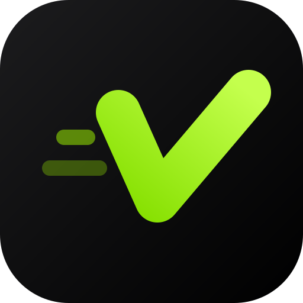

# VFit



VFit is a personal fitness tracker that runs in the browser and installs like an app on your phone and computer.
It tracks **strength workouts, cardio, body metrics, nutrition and supplements** over months and years of
training phases (Maingain, then a Cut, then…), works **offline**, and keeps your data **only on your device**:
no account, no server, nothing uploaded. Everything is metric (kg, km, cm).

**Live app:** https://vishalmurugan1986.github.io/VFit/ (GitHub Pages). Every push to `main` runs the
checks, builds and publishes it automatically (`.github/workflows/deploy.yml`).

## What it does

- **Workouts, built around routines**: plan each routine for weekdays and a gym session (morning or evening;
  your two gym times live in Settings → Alarms). The Workouts screen shows today's routine with **Start**, then
  your routines; Today's Workout button starts today's routine. Live logger (weight × reps, bodyweight reps,
  timed holds, warm-up sets), last session's numbers shown as you lift, rest timer with sound and vibration, a
  History screen (each workout marked Morning or Evening),
  personal records (estimated 1-rep max, heaviest, most reps, longest) and a progress chart per exercise
  (3 months to all time). Workouts per week, month or year. Comes with 49 beginner-to-intermediate
  exercises, each labelled with its level; add your own.
- **Goal & phases**: plan your training as phases (Bulk, Maingain or Cut), each with its own start date,
  target weight and daily calorie, protein, carbs, fat targets. A phase runs until the next one
  starts, so a phase you plan ahead takes over by itself on its start date. Each finished phase keeps its results
  (weight change, kg per week, average calories and days on target).
- **Cardio**: the common activities (walk, run, cycling, swim, elliptical) plus any you add yourself, measured
  by pace, speed or time only. Distance/time by week, month or year, plus all-time totals.
- **Body**: weight with a 7-day trend line, your phases shaded behind it, the current phase's target weight
  and rate of change; height and BMI, body fat.
- **Day check (how VFit knows what you did)**: Today's check lists each meal, the planned workout and
  supplements. A meal is done once food is logged under it, or you tap **Ate** (or mark it skipped); the workout
  is done when you log one, or mark it done, rest or missed; a day with no routine planned is a rest day.
  From an hour before bedtime a **Before-bed check** opens to tick off the rest and close the day, with the last
  7 days shown as rings. In the morning, Today nudges you if yesterday was left open.
- **Nutrition**: daily log by meal (Meal 1–4 to start; rename, reorder, set times or add your own), "My foods" for
  one-tap re-logging, copy the previous day. Each day is measured against the targets of the
  phase you were in that day. Trends for 7 days, 12 weeks or 12 months.
- **Supplements**: what you take, how much and when, a daily tick list, a 7-day record and 30-day adherence.
- **Alarms (iPhone)**: wake-up, morning and evening gym (30 min before), each meal, and bedtime, sent to
  the iPhone Clock app in one tap through a one-time Shortcut called **VFit Alarms** (web apps can't ring
  alarms themselves, and iPhone stops them when closed). Setup steps are in the app under Settings → Alarms.
- **Today** dashboard with three goal bars in this order: exercise minutes (out of 45), calories and protein, plus carbs and fat, and today's check, light/dark theme, backup download and restore.
- **Look**: the Apple Fitness iOS theme (from its Figma Community file): black background, #1C1C1E cards,
  Move red, Exercise green and Stand cyan, SF Pro text with SF Pro Rounded numbers on Apple devices (Inter elsewhere),
  with VFit's own goal bars on Today. Times are always 12-hour (6:30 AM), with a 12-hour picker wherever you set one. Cardio and Body use pulse-line and gauge icons. Dark by default; Light is in Settings.
- **Design system**: iOS-style throughout: a navigation bar on every screen that turns translucent and shows
  the title as you scroll, the iOS text-style scale, grouped lists, sheets with a grabber, 44pt touch targets,
  pressed feedback and short motion (off with Reduce Motion), and charts drawn to data-viz rules. The rules
  and components are written up in [DESIGN.md](DESIGN.md).

## Run it on this computer

```bash
npm install
```

```bash
npm run dev
```

Then open http://localhost:5173.

## Put it on your phone

To install it and use it offline, the app has to be served over **HTTPS**. Build it, then upload the
`dist` folder to any static host (Netlify Drop, Cloudflare Pages, GitHub Pages, Vercel...). It uses
relative paths and hash routing, so it works from any folder or sub-path with no server setup.

```bash
npm run check
```

```bash
npm run build
```

`public/_headers` (copied into `dist`) sets caching and security headers on Netlify and Cloudflare Pages:
the page, manifest and service worker are re-checked on every visit so updates arrive, and hashed files
are cached for good. Other hosts ignore it and the app still works.

**Updating later:** push to `main` (GitHub Pages rebuilds and publishes by itself), or build again and
upload the new `dist` to another host. The installed app shows "A new version of the app is
ready" with an **Update** button and switches over when you tap it, never in the middle of a workout. Your data is not touched by updates.

Open the hosted address on your phone, then:

- **iPhone**: Safari → Share → **Add to Home Screen**
- **Android**: Chrome menu → **Install app**

For a quick look on your phone over Wi-Fi first (no install or offline mode over plain http), run
`npm run dev -- --host` and open the "Network" address it prints.

## Launch checklist

1. **Check and build:** `npm run check`, then `npm run build`. The app is the `dist` folder (about 1.5 MB).
2. **Host it:** it's on GitHub Pages at https://vishalmurugan1986.github.io/VFit/. Push to `main` and the
   workflow checks, builds and publishes it (Actions tab shows progress). Any other static HTTPS host also
   works with the `dist` folder.
3. **Install on the iPhone:** open the address in Safari → Share → **Add to Home Screen** → **Add**, and open
   VFit from the Home Screen.
4. **Move your data:** on the computer you've been using, Settings → **Download backup**; get the file to the
   iPhone (AirDrop, iCloud Drive or Files); in VFit on the iPhone, Settings → **Restore backup**.
5. **Protect it:** Settings → **Protect from clean-up**, and keep the backup reminder on.
6. **Alarms:** make the **VFit Alarms** Shortcut once (steps in Settings → Alarms), then tap **Send … alarms to
   iPhone Clock**.
7. **Routines:** Workouts → edit each routine → pick its days and Morning or Evening.

## Your data

- Everything lives in your browser's IndexedDB on that device. Each browser and device has its own
  separate copy.
- **Back up now and then**: Settings → *Download backup*. Restore it on any device with *Restore backup*.
  The backup holds everything: workouts, routines, exercises, cardio and your activities, body entries,
  food log and saved foods, meal times and day checks, routine schedules, supplements and their tick history, phases and settings. Today reminds you
  when the last backup is older than a week (Settings → *Backup reminder*: weekly, 2 weeks or monthly).
- Built for years of use: tested with three years of daily data (8,760 food entries, 780+ workouts, 1,095
  weigh-ins). That backup is about 4.5 MB, takes a fraction of a second to make or restore, uses under 10 MB on
  the device, and every screen still opens in under a second.
- Backups from older versions of the app still restore; a goal saved before phases existed becomes your
  first phase.
- Install the app to your home screen, and use Settings → *Protect from clean-up*, so the browser
  doesn't clear the data when storage runs low. (Safari can clear data for websites you haven't opened
  for a while.)

## Scripts

| Command | What it does |
| --- | --- |
| `npm run dev` | Development server with hot reload |
| `npm run check` | Typecheck, lint and unit tests in one go (run before every release) |
| `npm run build` | Typecheck, then production build into `dist/` (includes the service worker) |
| `npm run preview` | Serve the production build locally |
| `npm test` | Unit tests (Vitest) for units, dates, periods, phases, meals, strength maths, pace, nutrition, trends, backups |
| `npm run lint` | Lint with oxlint |
| `npm run icons` | Regenerate the PNG app icons from the VFit logo in `assets/*.svg` |

## Project layout

```
src/
  db/          IndexedDB schema (Dexie), settings, queries, backup format
  lib/         Pure logic with tests: units, dates, periods, phases, strength (e1RM, PRs), cardio pace,
               nutrition, trends, supplements
  components/  UI kit (design system), charts, layout, toasts, confirm dialog, rest timer
  features/    Screens: today, workouts, cardio, body, nutrition, goal (phases), supplements, check (day check), alarm, settings
  dev/         Development only: ?demo sample data (never in a build)
assets/        Icon sources (SVG)
DESIGN.md      Design system: tokens, components, chart rules
scripts/       Icon generator
```

Built with Vite 8, React 19, TypeScript 7, Tailwind CSS 4, Dexie 4, Recharts 3 and vite-plugin-pwa.

**Note:** `package.json` swaps Rollup for its WebAssembly build (`@rollup/wasm-node`, via `overrides`).
The service-worker build uses Rollup, and a Windows Application Control policy on the development
machine blocked Rollup's native binary. The WebAssembly build behaves the same; you can remove the
override on machines that don't need it.
